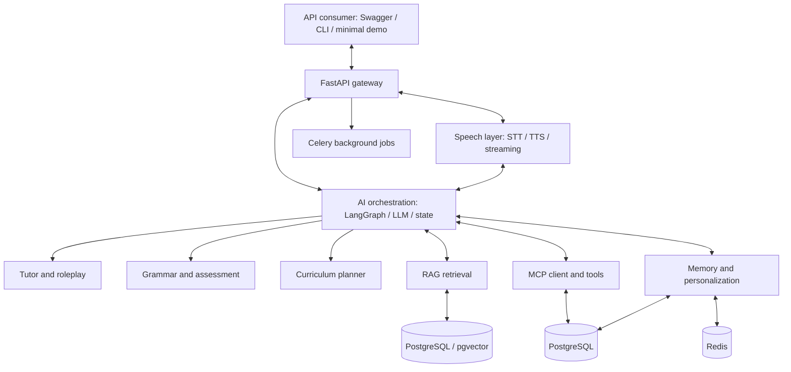

# Talk2 AI — AI Engineering Master Roadmap

## 1. Project vision
Build a production-ready, personalized Spanish AI tutor, inspired by conversational language learning applications. The project is an AI engineering portfolio and learning workshop targeting AI Engineer, GenAI Engineer, LLM Engineer and Agentic AI Engineer roles.

**Initial scope:** Spanish A1, text and eventually real-time voice, personalized lessons, roleplay, vocabulary, grammar feedback, pronunciation assessment, quizzes and progress tracking. Expand to other levels later.

**Development approach:** AI-led implementation with step-by-step explanations, engineering decisions, tests and interview preparation. Follow iterative Agile SDLC. Use free or low-cost services where feasible.

**Out of scope:** React, Next.js, Flutter, mobile applications, advanced frontend development, UI/UX, payments and marketing. Use Swagger, Postman, CLI or a minimal Streamlit demo solely for testing.

## 2. Master SDLC process

| Phase | Process | Deliverables | Status |
|---|---|---|---|
| 1 | Planning and feasibility | Vision, problem statement, objectives, scope, constraints, risks, MVP | Not started |
| 2 | Requirements analysis | SRS, functional and non-functional requirements, acceptance criteria, use cases | Not started |
| 3 | System design | HLD, LLD, ERD, UML, AI workflows, API contracts, ADRs | Not started |
| 4 | LLM implementation | Core tutor, prompts, structured output, streaming | Not started |
| 5 | RAG implementation | Ingestion, indexing, retrieval, reranking, evaluation | Not started |
| 6 | Agentic AI implementation | LangGraph workflows, tool calling, MCP integration | Not started |
| 7 | Memory and personalization | Persistent learner profiles, state and adaptive learning | Not started |
| 8 | Speech AI implementation | STT, TTS, audio streaming, pronunciation assessment | Not started |
| 9 | Backend integration | FastAPI, PostgreSQL, Redis, Celery, authentication | Not started |
| 10 | Testing and AI evaluation | Unit, integration, end-to-end, RAG and agent evaluations | Not started |
| 11 | Production deployment | Docker, CI/CD, cloud deployment, release controls | Not started |
| 12 | Maintenance and optimization | Monitoring, reliability, latency, cost and continuous improvement | Not started |

Phases 4–9 are implementation increments within the SDLC. Testing, documentation and security are continuous throughout, not postponed to the end.

## 3. Learning modules

### Module 1 — LLM Engineering
- [ ] Prompt engineering and system prompts: teaching behavior and constraints
- [ ] Structured outputs and Pydantic validation: corrections, lessons and quizzes
- [ ] Token management and context engineering: relevant learner information and cost control
- [ ] Model selection, benchmarking and generation parameters
- [ ] Provider abstraction, timeouts, retries and model fallbacks
- [ ] Response streaming and error handling
- [ ] Prompt versioning and prompt injection defenses

### Module 2 — Advanced RAG
- [ ] Educational document ingestion, source licensing and preprocessing
- [ ] Chunking strategies and metadata design (CEFR level, topic, source)
- [ ] Embedding models and vector similarity
- [ ] PostgreSQL/pgvector indexing and retrieval
- [ ] Dense search, BM25 and hybrid retrieval
- [ ] Metadata filtering, query rewriting and reranking
- [ ] Agentic RAG: determine whether retrieval is needed
- [ ] Grounded responses, source attribution and insufficient-evidence handling
- [ ] Retrieval and answer evaluation; compare baseline and improved pipelines

### Module 3 — Agentic AI
- [ ] Tool/function calling with validated schemas
- [ ] LangGraph nodes, edges, state and conditional routing
- [ ] ReAct patterns and bounded tool execution
- [ ] Checkpointing and resumable workflows
- [ ] Specialized tutor, evaluator and curriculum-planning capabilities
- [ ] Multi-agent systems experiment versus a single stateful workflow
- [ ] Human-in-the-loop where appropriate
- [ ] Guardrails, authorization, retries, loop limits and idempotency

### Module 4 — Model Context Protocol (MCP)
- [ ] MCP architecture: host, client and server
- [ ] Tools, resources and prompts
- [ ] Tool discovery, schemas and lifecycle
- [ ] Local stdio and remote HTTP transports, as supported by the chosen SDK
- [ ] Build a custom MCP server and connect it to the tutor
- [ ] Learning tools: lessons, vocabulary and assessments
- [ ] Student tools: profile, progress, mistakes and memory
- [ ] Knowledge tools: grammar and dictionary resources
- [ ] Authentication, authorization, input validation, error handling and testing
- [ ] Compare direct function calling with MCP; avoid unnecessary server separation

### Module 5 — AI Memory and Personalization
- [ ] Short-term conversation memory and workflow state
- [ ] Long-term learner history
- [ ] Semantic memory: learned vocabulary and concepts
- [ ] Episodic memory: prior learning sessions
- [ ] Procedural memory: teaching preferences and strategies
- [ ] Summarization, context budgeting and relevant memory retrieval
- [ ] Persistent state, checkpoints and session resumption
- [ ] Adaptive curriculum, spaced repetition and mistake tracking
- [ ] Data isolation, retention and deletion controls

### Module 6 — Speech and Real-time AI
- [ ] Speech-to-text (STT), Spanish transcription and transcription quality
- [ ] Text-to-speech (TTS), speaking speed and voice selection
- [ ] Voice activity detection (VAD)
- [ ] Audio streaming, chunking and buffering
- [ ] WebSockets; optional WebRTC comparison
- [ ] Turn-taking and interruption handling
- [ ] Audio-based pronunciation assessment (not transcript-only scoring)
- [ ] End-to-end latency measurement and optimization
- [ ] Audio privacy, consent and provider feasibility

### Module 7 — AI Evaluation and Optimization
- [ ] Golden datasets, rubrics and human-reviewed examples
- [ ] LLM-as-a-Judge and judge calibration
- [ ] Grammar correctness, teaching quality and level appropriateness
- [ ] Faithfulness, answer relevance, hallucination checks
- [ ] Retrieval precision, recall and ranking metrics
- [ ] Context precision and recall
- [ ] Agent tool selection, arguments and task success
- [ ] Regression tests and model benchmarking
- [ ] Latency, throughput, token use and cost measurement
- [ ] Optional quantization and local inference experiment
- [ ] Optional fine-tuning/LoRA experiment; compare against prompting and RAG

### Module 8 — AI Backend Engineering
- [ ] FastAPI routes, request/response schemas and dependency injection
- [ ] Async programming, streaming and WebSockets
- [ ] REST API design, versioning and OpenAPI documentation
- [ ] PostgreSQL, SQLAlchemy and Alembic migrations
- [ ] Redis caching, temporary sessions and rate limiting
- [ ] Celery background jobs, retries and task status
- [ ] Authentication (JWT/OAuth as appropriate), authorization and user isolation
- [ ] Configuration, secrets, exception handling and structured logging
- [ ] Pytest unit, integration and API tests

### Module 9 — LLMOps, MLOps and DevOps
- [ ] Git, GitHub, branching and pull requests
- [ ] Docker images, containers, volumes and networks
- [ ] Docker Compose for local multi-container development
- [ ] GitHub Actions CI/CD: lint, test, evaluation, build and deploy
- [ ] Prompt/model/config versioning and evaluation release gates
- [ ] Secrets management, dependency and image scanning
- [ ] Langfuse tracing and LLM observability
- [ ] Structured logs, metrics and cost/latency dashboards
- [ ] Cloud deployment (AWS or another suitable provider)
- [ ] Health checks, rollback, backups and recovery
- [ ] Load testing and performance optimization
- [ ] Optional Nginx, Terraform, Prometheus and Grafana

## 4. Proposed high-level architecture

Cross-cutting layers: authentication, authorization, validation, AI evaluation, tracing, logs, metrics, secrets and deployment infrastructure.

**Architecture decision:** Start with a modular monolith and separate workers where needed. MCP servers are logical responsibilities, not necessarily separate deployed services. Introduce distributed services only when justified.

## 5. Core AI processes

### 5.1 Tutoring and roleplay
1. Authenticate and validate the request.
2. Load learner profile, CEFR level, session state and relevant memory.
3. Route to tutoring, roleplay, quiz, or curriculum workflow.
4. Retrieve educational knowledge if required.
5. Generate level-appropriate structured output with the LLM.
6. Validate grammar feedback, tool arguments and response format.
7. Execute authorized progress updates; persist conversation state.
8. Stream or return the response and record trace/metrics.

### 5.2 RAG pipeline
1. Ingest approved Spanish educational resources and attach metadata.
2. Clean, chunk, embed and index documents.
3. Normalize/rewrite the query and filter by learner level.
4. Retrieve dense and keyword results, optionally combine and rerank.
5. Assemble a bounded context and generate a grounded answer.
6. Evaluate retrieval and response quality against labeled examples.

### 5.3 MCP tool execution
1. Discover available tools via the MCP client.
2. Select a relevant tool using the orchestration workflow.
3. Validate arguments and enforce user authorization.
4. Execute the tool through the server; validate results.
5. Feed the result back into the workflow and trace execution.
6. Retry only safe operations; avoid duplicate writes.

Proposed tools: `get_student_profile`, `get_student_progress`, `get_daily_lesson`, `save_vocabulary`, `record_grammar_mistake`, `get_weak_topics`, `save_assessment_result`.

### 5.4 Memory and personalization
Load learner state → retrieve relevant history → adapt difficulty → record validated mistakes and outcomes → schedule review → summarize and persist session state.

### 5.5 Voice conversation
Capture audio → VAD → STT → tutor workflow → grammar feedback and optional audio-based pronunciation assessment → TTS → stream audio → persist progress. Handle interruptions, disconnects and provider failures.

### 5.6 Assessment and curriculum
Select learning objectives → generate or retrieve level-appropriate questions → validate questions → collect answers → grade with explicit rubrics → record weaknesses → adapt future lessons.

### 5.7 CI/CD and deployment
Commit → pull request → lint/type checks → unit/integration tests → AI evaluation gates → container build/security checks → staging → smoke tests → approved deployment → monitoring and rollback if required.

### 5.8 Maintenance loop
Collect traces and metrics → identify quality/cost/latency regressions → investigate failures → update prompts, retrieval or code → run regression evaluations → release and monitor.

## 6. Design and documentation deliverables
- [ ] Project Vision Document
- [ ] Software Requirements Specification (SRS)
- [ ] Use Case Diagram
- [ ] High-Level Design (HLD)
- [ ] Low-Level Design (LLD)
- [ ] Entity Relationship Diagram (ERD)
- [ ] Class Diagram
- [ ] Sequence Diagrams (conversation, voice, RAG and tool calls)
- [ ] Data Flow Diagram (DFD)
- [ ] API Design and contracts
- [ ] AI Workflow Design (prompts, state, memory and tools)
- [ ] Deployment Diagram
- [ ] Testing and Evaluation Plan
- [ ] Architecture Decision Records (ADRs)

## 7. Technology stack

| Layer | Proposed technologies |
|---|---|
| Core | Python, Pydantic |
| LLM | Provider-neutral API abstraction, structured outputs, streaming |
| Orchestration | LangGraph, tool calling, MCP SDK |
| Retrieval | Embeddings, pgvector, BM25, reranking |
| Backend | FastAPI, REST, WebSockets |
| Data | PostgreSQL, SQLAlchemy, Alembic, Redis |
| Background jobs | Celery |
| Speech | Whisper or hosted STT, TTS, VAD, optional WebRTC |
| Testing | Pytest, custom evals, optional DeepEval |
| Observability | Langfuse, structured logging, optional Prometheus/Grafana |
| Infrastructure | GitHub, Docker, Docker Compose, GitHub Actions, cloud |
| Optional experiments | LoRA, quantization, Nginx, Terraform |

## 8. Workshop process for every lesson
1. Concept: understand the technology.
2. Business purpose: explain why Talk2 AI needs it.
3. Engineering decisions: compare alternatives and trade-offs.
4. Implementation: AI generates and explains code.
5. Testing: verify behavior and diagnose failures.
6. Interview preparation: practice relevant questions.
7. Documentation: update decisions, README and GitHub.

## 9. Current starting point — Phase 1
- [ ] Lesson 1: Project vision, problem statement and objectives.
- [ ] Lesson 2: Scope, feasibility, constraints and risks.
- [ ] Lesson 3: MVP definition and measurable success criteria.

Then proceed to requirements analysis and system design before implementation.

## 10. Assumptions and open decisions
- The MVP is proposed to start with text tutoring and add real-time voice after the core AI pipeline is validated.
- Initial A1 scope, model providers, hosting, budget and measurable performance targets remain subject to feasibility and requirements review.
- Free-tier availability, speech latency and pronunciation scoring quality have not been verified.
- RAG, MCP and other technologies must solve an actual problem or be clearly labeled learning experiments; not every optional technology belongs in production.
- No implementation or design deliverable has been completed merely by creating this roadmap.
